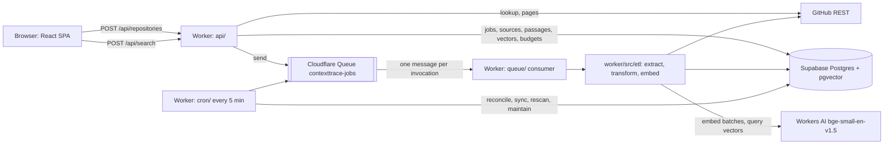

# Architecture

ContextTrace turns the discussions of a public GitHub repository (issues, pull requests, their
comments and review comments) into searchable evidence: every result is a passage with a verified
permalink back to the comment it came from. Everything runs on free tiers: a Cloudflare Worker (API,
queue consumer, cron, static SPA), Workers AI for embeddings, Supabase Postgres with pgvector for
storage and search, and the GitHub REST API as the only source.

## Components

| Directory | Role |
| --- | --- |
| `web/src` | React + Vite single-page app: registration form (with Turnstile when configured), live coverage panel, search panel with evidence cards, service status banner. Served as Worker static assets with a strict CSP (`web/public/_headers`), and published to GitHub Pages under `/ContextTrace/` by `.github/workflows/pages.yml`, where it calls the Worker across origins (`ALLOWED_ORIGINS`) with the same policy in a meta tag. |
| `worker/src/api` | HTTP routes and everything a request needs: validation, rate limits, Turnstile, admin token, admissions, registration, search, evidence cards, coverage, status, repositories. |
| `worker/src/queue` | The job system: `jobs` rows are the source of truth, queue messages carry only ids and a generation; claims with leases, retries with backoff, budget pauses, the consumer that runs one job per invocation, and the budget ledger. |
| `worker/src/etl` | GitHub extraction streams (issues and pull requests, issue comments, review comments) with durable per-stream cursors; Markdown normalisation; token-bounded chunking with the model's own WordPiece tokenizer; deterministic passage ids and content hashes; embedding with pgvector storage. |
| `worker/src/cron` | Every five minutes: resend lost messages, queue due syncs and rescans, purge old history, remove repositories that GitHub stopped serving, measure storage. |
| `migrations` | Supabase SQL: tables, RLS, grants, and the functions the Worker calls (`upsert_sources`, `sync_passages`, `search_passages`, `reserve_budget`, ...). `supabase/migrations` links here for the CLI. |
| `tests/integration` | Vitest under the Workers runtime against the live Supabase project, with GitHub, Workers AI and Turnstile stubbed; `tests/fixtures` holds the thread fixtures; `tests/evaluation` the frozen question set, the metrics and the public-API evaluation runner. |

## Data flow: from a URL to an evidence card

1. **Registration.** `POST /api/repositories` validates the URL, checks Turnstile and admissions, reserves a registration in the budget, looks the repository up on GitHub (public only), upserts the row keyed by GitHub's numeric id (stable across renames) and queues one `fetch_<stream>` job per stream.
2. **Head pass.** Each stream's first run lists the newest two pages (descending by update time), stores them through `upsert_sources` (newest copy wins, unchanged rows only move `seen_at`), sets the stream's high-water mark and leaves the next page in the checkpoint's cursor for the backfill.
3. **Backfill.** `backfill_<stream>` jobs continue the listing three pages per run, re-queued with a 10 s delay so other repositories' head passes and syncs get ahead on the shared queue, until the end or the 5,000-item cap. The high-water mark is never moved by a backfill.
4. **Transform.** After every stream run that changed something, `transform_passages` groups the dirty threads' sources into documents, normalises Markdown, splits each unit into passages of at most 256 model tokens, computes deterministic ids and content hashes, and writes them through `sync_passages`, which leaves unchanged passages untouched and removes parts that no longer exist (their vectors cascade away).
5. **Embed.** `embed_passages` takes pending passages in batches sorted by length (Workers AI meters a batch at its longest text), reserves the inference budget, calls the model with `cls` pooling, validates every vector, stores them in `passage_embeddings` and marks the passages active. The repository becomes `searchable_partial` after the first stored batch and `searchable` when every stream is complete and nothing is pending.
6. **Search.** `POST /api/search` embeds the query on the server, ranks the repository's active vectors by cosine on the HNSW index, and decides: a top score at or above 0.80 is a high-confidence semantic answer; otherwise the keyword baseline (Postgres full-text search) answers if it matches; weak semantic hits between 0.70 and 0.80 are shown with a warning; else "no supporting discussion". Hits become cards with title, locator, author, date, a 300-character excerpt and a permalink that is verified (host, thread, comment anchor) before the card is shown. The response always carries the index state (partial, capped, inaccessible, removed) and a message that says what the reader should know.
7. **Sync.** The cron queues a `fetch_<stream>` job every hour per complete stream; it lists ascending since the high-water mark minus five minutes, so re-read unchanged items cost nothing, and chains the transform and the embedding only when something changed. A weekly low-priority rescan walks each stream from the start and retires rows GitHub no longer lists, with their passages and vectors.

## Jobs: states, leases, retries, pauses

`queued → running → succeeded | failed | cancelled`, plus `running → retry_pending → running`. A message carries the job's generation; `claim_job` leases the row for one owner, a redelivery to the same owner extends the lease, another owner takes over only after it expires, and a late finish by the old owner is fenced. Transient failures (GitHub or model rate limits, 5xx, network, the database being unavailable) back off from 30 s doubling to 15 minutes for at most five attempts; permanent failures (bad input, constraint violations, invalid cursors) fail at once. A refused budget reservation parks the job until the budget's window resets without consuming an attempt. Every transition is recorded in `job_transitions`.

## Free-tier budgets and protections

`usage_budgets` holds one row per resource at 80% of the free allowance: Workers AI neurons per day, GitHub requests per hour, queue operations per day, searches and registrations per day, egress per month and storage as a gauge. Every metered call reserves first through `reserve_budget` (atomic, window-aware); a refusal pauses the job, falls a search back to keywords, or answers 429/503 with `Retry-After`. Per-address rate limits (30 searches, 5 registrations, 120 reads a minute), optional Turnstile on registration, an admin token on job triggers and repository removal, an 8 KB body cap, pinned fetch targets (only GitHub's API under the job's repository) and a strict CSP complete the picture. `GET /api/status` reports all of it.

## Where things are measured

`docs/benchmarks/` (queue consumer and transform/embed benchmarks on p-limit), `docs/milestone-6-acceptance.md` (progressive coverage and sync, live), `docs/milestone-7-acceptance.md` (CPU on Workers Free, budget pause and resume, live), `docs/EVALUATION.md` (retrieval quality on the frozen question set).
